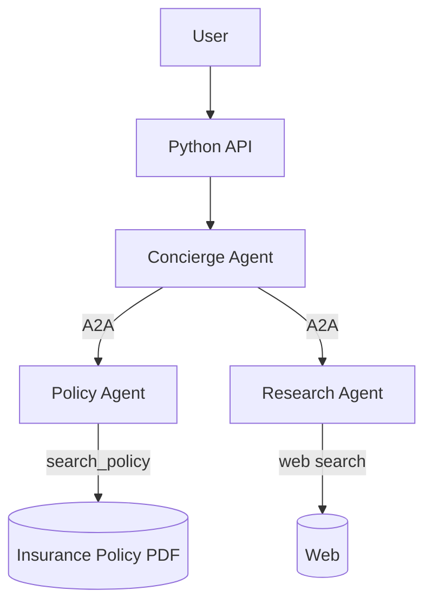

# Health Concierge

A multi-agent healthcare assistant that demonstrates specialist-agent collaboration through the A2A protocol. The system routes user questions to a policy specialist for insurance questions and a research specialist for healthcare questions, then synthesizes a single response through a healthcare concierge.

## Key capabilities

- browser chat with visible questions/replies, selectable examples and a connection indicator
- insurance policy retrieval
- healthcare web research
- intelligent routing
- multi-agent orchestration
- A2A communication

## Architecture overview



## Responsibilities

### Concierge Agent
The concierge is the orchestration layer. It receives the user question, decides which specialist agent is relevant, and synthesizes final responses from the returned specialist knowledge.

### Policy Agent
The policy agent answers insurance questions using the local PDF retrieval tool. It remains scoped to coverage, deductibles, copays, in-network/out-of-network costs, and exclusions.

### Research Agent
The research agent answers healthcare research questions using web search. It is responsible for symptoms, conditions, treatments, procedures, and healthcare options.

## smolagents vs A2A vs Tools

- smolagents = reasoning inside an agent
- A2A = communication between agents
- tools = capabilities available to an individual agent

This project keeps those boundaries explicit: the concierge never touches the PDF or web-search implementation directly; it calls specialist agents over A2A.

## Project structure

- `agents/`: concierge and specialist agents
- `a2a_clients/`, `a2a_servers/`: specialist communication
- `backend/`: API and static frontend server
- `frontend/`: HTML, CSS and JavaScript (no build required)
- `tools/`: specialist and concierge tools
- `data/`: insurance policy document
- `tests/`: API, frontend and browser regression tests
- `docs/`: architecture and development instructions

## Setup

This project uses Python 3.13 and `uv` for environment management.

```bash
uv sync
```

Copy `.env.example` to `.env` only if that file does not already exist (`Copy-Item .env.example .env` in PowerShell, or `cp .env.example .env` in a POSIX shell). Configure:

- `OPENAI_API_KEY` with access to `gpt-4o` and available API credit
- `A2A_BIND_HOST` (optional)
- `POLICY_AGENT_PORT` (optional)
- `RESEARCH_AGENT_PORT` (optional)
- `POLICY_AGENT_PUBLIC_URL` and `RESEARCH_AGENT_PUBLIC_URL` if changing specialist addresses
- `BACKEND_HOST` / `BACKEND_PORT` (defaults: `127.0.0.1:8000`)

## Running the application

Open three terminals from the project root.

### Terminal 1: Policy agent

```bash
uv run python -m a2a_servers.policy_server
```

### Terminal 2: Research agent

```bash
uv run python -m a2a_servers.research_server
```

### Terminal 3: Backend API

```bash
uv run python -m backend.server
```

Open **http://127.0.0.1:8000** in your browser. The backend serves the frontend and API together; no npm installation or separate frontend server is needed.

The connection indicator turns green when the concierge initializes and both specialist endpoints are reachable. Click it to recheck. This is a service health check, not a validation of model access.

Select an example question or type your own. Questions and answers remain visible until refresh, but each request is independent: previous messages are not sent to the agent.

See [the development guide](docs/development.md) for configuration, tests and troubleshooting, and [the architecture guide](docs/architecture.md) for API contracts.

## Verification

```bash
uv run python -m pytest tests -q -p no:cacheprovider
node --test tests/frontend.test.cjs
```

Browser tests require Chrome and a matching Selenium driver; frontend unit tests require Node.js 22+. Automated tests use deterministic substitutes and do not make paid model calls.

## Example queries

### Policy only

- How much would I pay for mental health therapy?

### Research only

- What are the common treatments for sleep apnea?

### Multi-agent

- What treatments are available for sleep apnea and does my insurance cover them?

## Current limitations

- The healthcare workflow is a local development architecture with separate local services.
- There is no authentication layer. Keep the services bound to loopback; they are not ready for public deployment.
- Conversation history is neither persisted nor supplied as model context.
- Specialist execution is synchronous and local-process based.
- This project is for demonstration and tooling, not clinical diagnosis.

## Roadmap

Future work includes:

- Provider Agent
- MCP integration
- persistent conversation memory
- streaming responses
- observability and tracing
- containerization
- authentication
- production deployment

These are future directions, not implemented features in the current project.
