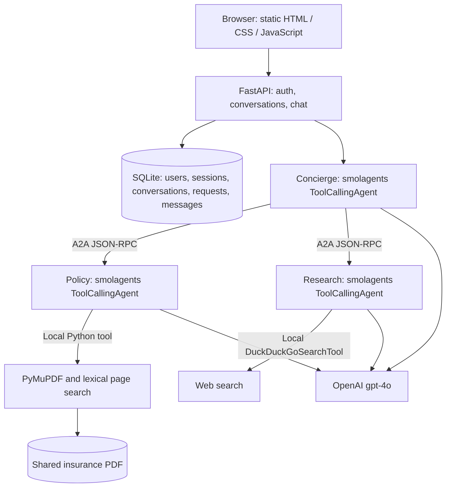

# Architecture

## Overview

This document describes **implemented behavior**, verified against the repository on 2026-09-28. Agentic Lab is the laboratory; MediNova Healthcare Concierge is the reference application. Future architectures belong in the [roadmap](roadmap.md). A dependency, prompt instruction or planned Jira ticket is not evidence that a capability has been validated in production.

The project implements a healthcare concierge built around a small multi-agent pattern:

- a concierge agent orchestrates the conversation
- a policy specialist handles insurance questions
- a research specialist handles general healthcare questions
- each specialist runs as an A2A-compatible service
- the front end calls a lightweight Python API layer

This keeps the user experience simple while preserving the agent boundaries that matter for correctness and trust.

There are three server processes. The concierge runs inside the backend process, and the backend also serves the frontend. There is no separate frontend server, concierge server, MCP service, vector database or container runtime configured in the repository.

## Implementation map

| Layer | Source | Actual responsibility |
| --- | --- | --- |
| UI | `frontend/index.html`, `styles.css`, `app.js` | Accounts, messages, conversation list, examples and connection indicator |
| API | `backend/api.py`, `backend/server.py` | FastAPI/Uvicorn, same-origin assets, validation and serialized concierge access |
| Identity and persistence | `backend/auth.py`, `backend/storage.py` | Local accounts, session/CSRF checks, SQLite ownership and turn persistence |
| Orchestration | `agents/concierge_agent.py`, `agents/conversation_memory.py` | Routing prompt, bounded history and response synthesis |
| Specialist adapters | `tools/concierge_tools.py`, `a2a_clients/client_utils.py` | Python tools bridging synchronous agent execution to asynchronous A2A clients |
| Specialists | `agents/policy_agent.py`, `agents/research_agent.py` | Domain prompts and local retrieval/search tools |
| A2A servers | `a2a_servers/policy_server.py`, `research_server.py` | Starlette, agent cards, JSON-RPC and in-memory A2A task stores |

All three agents instantiate `OpenAIServerModel(model_id="gpt-4o")`; there is no application-level model/provider selector. Concierge and Research have `max_steps=8`, Policy has `max_steps=6`. Prompts are inline Python strings versioned with the code, not a separate prompt registry. `main.py` is a terminal interface: it calls the concierge directly, does not provide the web account/history flow and does not itself load `.env`.

## Request flow

1. The user enters a question in the static HTML/JavaScript front end.
2. The front end sends the message, conversation UUID and stable request UUID to `/api/chat`, with the session cookie and CSRF header.
3. The API checks ownership, acquires its nonblocking query lock, reuses a saved result for a completed retry or persists a pending turn, then loads completed history and invokes `answer_query_with_metadata()`.
4. The concierge agent runs a `ToolCallingAgent` with `ask_policy` and `ask_research` tools.
5. Each tool sends a request to one of the specialist A2A services.
6. The specialist returns domain-specific information.
7. The concierge synthesizes the final answer and returns it to the API.
8. The API validates and saves the response with the completed turn, then sends it to the browser, which reloads persisted messages. Failed turns are marked for retry.

## Agent boundaries

### Concierge agent

The concierge is responsible for:

- deciding whether the question is policy-focused, research-focused, or mixed
- invoking the correct specialist tool(s)
- combining specialist output into a single response
- returning metadata like which specialist agents were used

It does not perform the policy lookup or web research itself. It delegates those tasks to specialty services.

### Policy agent

The policy agent answers questions about:

- coverage and benefits
- deductibles and copays
- coinsurance
- exclusions and limitations
- in-network and out-of-network differences

It uses the local PDF-based retrieval tool attached to the policy service.

`tools/policy_tools.py` loads `data/2026AnthemgHIPSBC.pdf` at import time with PyMuPDF. Run from the repository root because this path is relative to the working directory. It preserves one-based page numbers, splits the lowercased query on whitespace and scores each page by how many distinct query terms occur as substrings. It returns at most three matching pages, each truncated to 5,000 characters, with source/page labels.

This is a lexical retrieval baseline, not embedding-based semantic search. There is no chunking pipeline, vector store, hybrid search, reranker, upload flow or per-user document corpus. The prompt requests grounded answers and page references; citation accuracy is not automatically scored or enforced.

### Research agent

The research agent answers questions about:

- symptoms and disease descriptions
- treatment options
- medical procedures
- general healthcare context

It uses search-oriented tools and responds with internet-derived context.

The concrete tool is smolagents' `DuckDuckGoSearchTool`. The prompt requests reliable sources and URLs when available. This is not an allowlisted or independently verified medical-source pipeline, and current regression tests do not establish clinical accuracy.

## A2A communication

The specialist services expose agent cards and callable endpoints. The concierge calls them through the A2A client utilities in `a2a_clients/`.

The relevant layers are:

- `a2a_servers/policy_server.py`
- `a2a_servers/research_server.py`
- `a2a_clients/client_utils.py`
- `tools/concierge_tools.py`

This allows the orchestration layer to remain loosely coupled from the specialist implementation.

Both servers advertise A2A 1.0 / JSON-RPC at `/`, expose `/.well-known/agent-card.json`, set `streaming=False` and use `InMemoryTaskStore`. Their executors call synchronous specialists through `asyncio.to_thread`. The `cancel()` methods are no-ops; durable A2A task recovery and cancellation are not implemented. SQLite conversation persistence is separate from these in-memory task stores.

| Process | Default listener | Entrypoint from repository root |
| --- | --- | --- |
| UI/API/concierge | `127.0.0.1:8000` | `uv run python -m backend.server` |
| Policy | `127.0.0.1:9999` | `uv run python -m a2a_servers.policy_server` |
| Research | `127.0.0.1:9998` | `uv run python -m a2a_servers.research_server` |

See [development configuration](development.md#configuration-and-service-lifecycle) and [`.env.example`](../.env.example) for environment variables. `POLICY_AGENT_PUBLIC_URL` and `RESEARCH_AGENT_PUBLIC_URL` are used for both discovery and calls. Policy's server alone also recognizes the legacy `A2A_PUBLIC_URL` fallback; clients do not, so use the explicit specialist variables.

## Health model

The API health endpoint checks the status of each service through the `get_health()` method on the concierge. That method probes:

- whether the concierge can be initialized locally (no model inference call)
- the policy agent card URL
- the research agent card URL

The frontend shows a compact indicator: green when all services are available, amber when specialists are unavailable or service is degraded, red when the concierge cannot be reached or initialized. Hover text provides details; clicking reruns the check. It does not verify model credentials, quota, or outbound inference connectivity.

## Data flow and contracts

The API contract is intentionally small:

- POST `/api/chat`
  - body: `{ "message": "...", "conversation_id": "UUID", "request_id": "UUID" }` (authenticated session and CSRF header required)
  - response: `{ "answer": "...", "agents_used": ["..."], "request_id": "...", "latency_ms": 123, "conversation_id": "..." }`
- GET `/api/health`
  - response: status summary for the concierge, policy service, and research service

This gives the browser a stable API surface while hiding the A2A and tool-layer complexity.

## Execution and browser state

The backend creates the real concierge lazily after loading `.env`. Chat and health handlers run in FastAPI worker threads, allowing synchronous smolagents tools to call `asyncio.run()` for A2A work. A nonblocking lock permits one active concierge query per API process; concurrent queries receive 503 instead of waiting indefinitely. Tool usage metadata comes from completed agent memory, including parallel specialist calls.

The browser sends the current question, conversation ID and stable request ID. The backend identifies the owner from a server-side session, loads authorized completed turns from SQLite and supplies bounded context. Agent memory is reset for every run. The browser reloads persisted messages and renders content using `textContent`. See [accounts and memory](accounts-and-memory.md) for the schema, endpoints and lifecycle.

The backend serves the frontend on the same origin. Static HTML/CSS/JavaScript responses use `Cache-Control: no-store`, including conditional requests. Versioned asset URLs prevent clients with older cached assets from mixing frontend versions.

### Chat validation and errors

Messages must contain non-whitespace text and may contain at most 8,000 characters. Empty/invalid input returns 400 or 422. Response payloads are validated before returning them to the browser.

| Status | Meaning |
| --- | --- |
| 502 | Agent execution failed or returned an invalid/empty response |
| 503 | Concierge initialization unavailable, or another query is running |
| 504 | A `TimeoutError` reached the API from specialist execution |

The browser aborts its request after three minutes. This does not cancel work already executing in the server. Local account authentication and SQLite persistence are implemented. Streaming and public deployment hardening are not implemented. Only a single backend worker is supported.

## Why this design works

The project deliberately separates:

- reasoning (`smolagents` inside each agent)
- inter-agent communication (`A2A`)
- tool execution (PDF retrieval and web search)

That separation gives future experiments a starting point. Swapping frameworks or models is not yet a configuration-only operation: adapters and compatibility tests still need to be designed. A2A currently separates agents, while tools are local Python calls. MCP will address agent-to-tool/data interoperability; it will not replace A2A. Framework, model/provider and cloud/runtime must remain distinct decisions.

## Evidence, observability and security limits

Implemented operational metadata includes `agents_used`, a request UUID and `latency_ms`. For the real concierge, latency covers its agent run, not the entire HTTP/storage path; a reused result retains its original metadata. These fields are not distributed traces or a benchmark. There is no token/cost accounting, span propagation across A2A, p50/p95 aggregation, OpenTelemetry, MLflow, LangSmith or Langfuse integration.

The backend redacts submitted inputs from validation errors and logs exception types for chat failures. However, **both A2A servers print full questions and answers**. Logging redaction remains work to complete before sharing environments or using private health information. Low smolagents verbosity does not remove those prints.

Local security includes hashed passwords and session tokens, revocable cookies, CSRF/origin checks, parameterized SQL, ownership checks, input/response validation and in-process rate limits. The A2A endpoints have no application-level authentication/authorization. Registration is open to anyone who can reach the service; data and backups are not encrypted by the application. There is no dedicated prompt-injection defense, tool authorization policy, PII filtering or human approval workflow. Prompt instructions do not enforce such boundaries.

HTTPX specialist calls use 60-second Policy and 120-second Research timeout settings; these are not guaranteed end-to-end execution deadlines. The browser aborts after 180 seconds without cancelling model execution. Step limits and local rate limits are useful bounds, but not token budgets or billing caps.

Tests currently live directly in `tests/`: Python API/auth/storage/memory/configuration tests, Node frontend tests and Selenium browser flows. Browser tests use a deterministic concierge and temporary SQLite databases. They do not validate real model quality, medical correctness, real A2A interoperability under load or cloud operations. No CI workflow, Dockerfile, Compose configuration, Terraform module or AI evaluation dataset is present. Consult the [roadmap](roadmap.md) for the planned validation layers.
