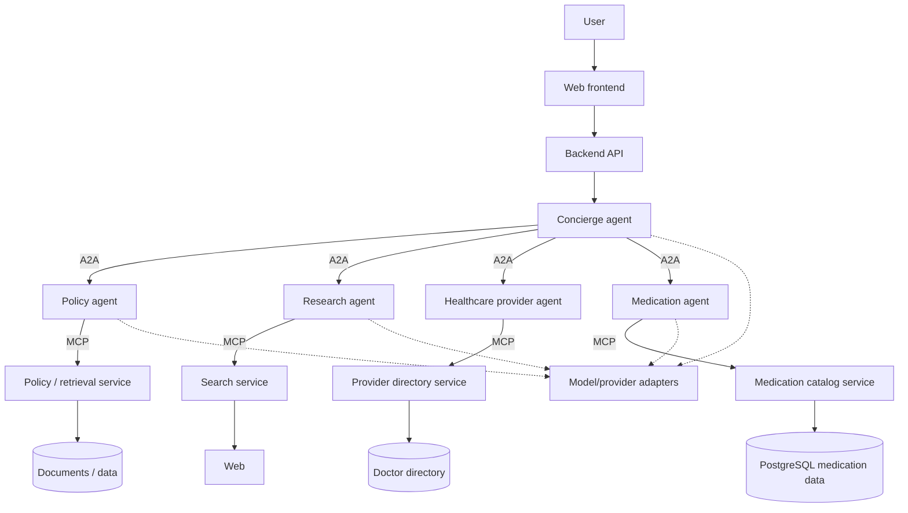

# Agentic Lab — vision and learning roadmap

## Purpose

Agentic Lab is a personal AI Engineering / MLOps / LLMOps / AgentOps laboratory. MediNova Healthcare Concierge is the reference application, not the limit of the project's ambition. Build one realistic application, then retain its use case, contracts and evaluation workload while replacing selected technical layers.

The professional goal is to explain where technologies belong, why one approach fits a workload, and what changes in quality, latency, cost, reliability, portability, observability and operational complexity. A deployed demo is one milestone, not the final deliverable. The final outcome is a reproducible engineering comparison backed by measured evidence.

## Status and evidence

Baseline rechecked on **2026-10-14**. Status describes repository implementation, not Jira ticket creation or an unverified running environment:

- **[IMPLEMENTED]**: concrete code or documentation exists; its validation limits must still be stated.
- **[IN PROGRESS]**: part of a phase exists, but its completion criteria are not met.
- **[PLANNED]**: intended work, with no claim of implementation, deployment or measured results.

| Capability | Status | Evidence / limitation |
| --- | --- | --- |
| Web UI and FastAPI | [IMPLEMENTED] | `frontend/`, `src/medinova/backend/api.py`; local same-origin app, no separate frontend build |
| Accounts, history and memory | [IMPLEMENTED] | `src/medinova/backend/auth.py`, `src/medinova/backend/storage.py`, `src/medinova/agents/conversation_memory.py`; SQLite and bounded per-conversation context |
| Modular agents | [IMPLEMENTED] | `config/agents.yaml`, `src/medinova/agents/runtime.py`; concierge uses smolagents/OpenAI and A2A delegates; four specialists use LangChain with OpenAI or Hugging Face and MCP tools |
| Specialist A2A communication | [IMPLEMENTED] | Generic `src/medinova/a2a_servers/serve.py` and `src/medinova/a2a_clients/client_utils.py`; concierge calls four specialists over local JSON-RPC, without streaming or service authentication |
| Policy retrieval | [IMPLEMENTED] | `src/medinova/mcp_servers/policy.py`; MCP tool with lexical page scoring over one shared PDF |
| Research search | [IMPLEMENTED] | `src/medinova/mcp_servers/research.py`; MCP web search with source URLs and guidance in `src/medinova/prompts/research.md` |
| Provider directory via MCP | [IMPLEMENTED] | `src/medinova/mcp_servers/healthcare.py` exposes `list_doctors` over stdio to the LangChain specialist; static local JSON data |
| Medication catalog via MCP | [IMPLEMENTED] | `src/medinova/mcp_servers/medication.py` exposes `get_medication` over stdio; structured sample from the French BDPM in PostgreSQL, imported on demand |
| Container configuration | [IMPLEMENTED] | `Dockerfile.agent`, `Dockerfile.backend`, `docker-compose.yml` and HTTPS override; the local Compose stack has been exercised manually, while image security scans are still pending |
| Regression tests | [IMPLEMENTED] | `tests/`; deterministic substitutes, not live AI quality benchmarks |
| Request metadata | [IMPLEMENTED] | Concierge latency, selected specialists and idempotency IDs, plus opt-in metadata-only distributed tracing |
| V1 completion | [IN PROGRESS] | Functional local foundation exists; final validation and operational gaps remain |
| Benchmark, tracing, additional provider adapters | [IN PROGRESS] | Opt-in metadata-only Langfuse timeline across backend, A2A, agents, model calls and local MCP tools; no AI quality dataset or general provider adapter registry |
| Baseline CI | [IMPLEMENTED] | `.github/workflows/ci.yml` checks the lockfile, Ruff lint, deterministic tests including in-memory A2A and A2A-to-MCP exchanges, wheel build, committed secrets and locked production dependencies; `image-security.yml` scans both built images for fixable critical vulnerabilities on every PR and weekly; no live AI evaluation |
| Required checks on `master` | [PLANNED] | The repository remains private on GitHub Free by choice; CI results are visible but cannot block a merge. Revisit branch protection if an eligible plan becomes available. |
| Alternative frameworks, Terraform and clouds | [PLANNED] | No deployment artifacts or measured comparisons |

Detailed current behavior, startup and test commands, and identity/storage contracts belong in [architecture](architecture.md). Do not interpret existing test coverage as evidence of answer quality or production readiness.

## Separate the layers

| Layer | Responsibility | Current baseline | Planned investigations |
| --- | --- | --- | --- |
| Agent framework | Reasoning loop, state and internal orchestration | smolagents concierge and LangChain MCP specialists | LangGraph, Strands, Google ADK, Microsoft Agent Framework |
| A2A | Agent-to-agent communication | Concierge to Policy, Research, Healthcare Provider and Medication | Preserve the boundary when replacing implementations |
| Tools / MCP | Agent-to-tool, data and service access | MCP stdio for policy, research, provider directory and medication catalog | Evaluate further data boundaries, authorization and protocol overhead |
| Model/provider | Inference and model access | Configured OpenAI gpt-4o and Hugging Face gpt-oss-20b | Claude, Gemini; Bedrock, Vertex AI, Azure; selected open models |
| Runtime/cloud | Hosting, identity, network, scaling and operations | Local Python processes and Compose definitions | Validate containers, then AWS, GCP, Azure and managed runtimes |
| Evaluation/operations | Evidence, traces, costs and experiment provenance | Regression tests and basic metadata | Benchmark, OpenTelemetry, experiment tracking and FinOps |

Framework, model family, provider API and runtime are different variables. For example, using Strands does not by itself mean the application runs on AgentCore or calls Bedrock. Candidate integrations must be checked for support, regional availability, quotas and cost at implementation time; this roadmap is not a compatibility guarantee.

The following diagram shows the current A2A and MCP boundaries. The model/provider adapter box represents an area for future experiments:

Modularity does not require a separate network service for every box. Today frontend, API and concierge share the backend process. Four specialists have separate A2A services; their MCP servers are stdio subprocesses. Add further services only when the experiment or deployment needs that boundary.

## Ordered delivery phases

Follow the phase order below. Security and cost controls apply from the beginning; phase 11 deepens them rather than postponing essential protections. Phase completion requires evidence, not merely adding a dependency.

### 1. Finish the current V1 — [IN PROGRESS]

**Learn:** agent loops, tool calling, model-driven routing, A2A boundaries and MCP tool access with smolagents and LangChain.

**Existing:** browser chat, account/history flows, backend API, concierge and specialists, bounded memory, tests and documentation.

**Remaining:** review desktop/mobile usability, validate policy-only/research-only/provider-only/mixed/follow-up scenarios, characterize failure paths and correct gaps uncovered by essential tests. Document single-worker/concurrency limits and shared-PDF behavior.

**Exit evidence:** reproducible local demo, readable architecture, essential regression checks recorded, and a clear list of limitations. Existing backend/frontend components should be refined, not rebuilt unnecessarily.

### 2. Containerization — [IN PROGRESS]

**Learn:** images, runtime configuration, internal networking, healthchecks and persistent volumes.

**Existing:** a shared specialist Dockerfile, backend Dockerfile, `.dockerignore`, Compose definition for four services, and optional HTTPS/Caddy override. Compose configuration parses but the full stack has not been run and measured here.

**Remaining:** build and start all four services on a clean machine, verify A2A/MCP requests and healthchecks, then restart and restore the SQLite volume. Keep secrets and local databases out of images. Future vLLM services are added only when an experiment needs them.

**Exit evidence:** `docker compose up --build` reproduces the full local application from documented configuration on a clean machine, with persistence and restart checks. A successful configuration parse alone does not meet this criterion.

### 3. Evaluation and observability — [IN PROGRESS]

**Evaluation baseline in development:** `evaluation/cases/v1.json` holds two versioned example cases. `medinova.evaluation` loads and grades them independently of Langfuse, and `python -m medinova.evaluation.runner` runs them against the local concierge when the A2A services and model credentials are available. The report contains case IDs, deterministic check failures, duration and available token counts; it omits questions and answers. These checks are a starting point for routing and fact-presence regression, not a medical-quality score. They are not run in CI because they require live services and paid model calls. More cases, evidence-level grading, repetitions, cost accounting and a reviewed baseline report remain to be done.

**Learn:** separate software correctness from AI quality; measure behavior before comparing technologies.

**Existing first step:** opt-in Langfuse span for each new backend chat attempt, with request UUID, status, latency, specialists, tool names/durations, agent steps and available model token counts. A2A requests carry trace IDs; specialist agents, model calls and selected MCP tool calls create timed observations. Local stdio MCP servers also record server-side tool execution through a shared wrapper. Specialists return metrics in A2A response metadata. `usage-*` generation observations summarize tokens and estimated cost while timed `model-*` observations measure the individual calls; this avoids double-counting cost. Langfuse can infer costs for matching priced models when usage exists; incomplete usage or unsupported pricing remains unknown. Questions, answers, prompts, tool arguments and MCP results are excluded. This is not yet an AI quality evaluation or a trace of third-party MCP servers.

**Deliver:** repository-owned, versioned evaluation cases for policy, research, routing, mixed requests, retrieval, tool use, follow-up memory and safety. Define expected evidence, grading rules and failure categories. Add privacy-preserving correlation across backend, concierge, model calls, A2A and retrieval/search without exporting chat content. Run the same cases and rubrics through separate Langfuse, LangSmith, MLflow and W&B Weave pilots; compare usefulness, privacy controls, operational effort and cost. Keep the evaluation dataset and results portable rather than binding them to one vendor.

**Exit evidence:** a repeatable baseline report containing quality, latency, token/cost measurements and failures, plus a trace following one complete request. Record what remains unmeasured. Do not begin framework/model/cloud comparisons before this baseline.

### 4. Additional MCP tool/data boundaries — [PLANNED]

**Learn:** agent-to-tool interoperability, contracts, error handling and authorization.

**Existing:** policy, research and healthcare-provider specialists use MCP stdio tools. The agent's tools list selects from tools discovered on its configured servers.

**Deliver:** measure the behavior and overhead of the migrated policy/search capabilities against the earlier local-tool baseline. Add trace propagation and service-side authorization independently of model decisions. The migration also changed the specialist framework, so any causal comparison must account for that difference.

**Exit evidence:** the same evaluation suite runs against local-tool and MCP variants, with functional differences and protocol overhead reported. Installing a development assistant's MCP/plugin does not count as implementing MCP inside MediNova.

### 5. Generic AWS deployment — [PLANNED]

**Learn:** cloud hosting with general infrastructure before adopting a managed agent runtime.

**Candidates:** ECR, ECS/Fargate, S3, IAM, Secrets Manager and CloudWatch; load balancing/API Gateway and Lambda only when justified. Bedrock access is a later controlled provider experiment within the phase, not an automatic change alongside hosting.

**Deliver:** Terraform, a versioned delivery pipeline, least-privilege identity/networking, HTTPS, persistent storage and backups suited to the chosen runtime. Explicitly resolve SQLite and single-worker constraints before using ephemeral/multiple instances. Define budgets, alerts, quotas, maximum scale and teardown procedures.

**Exit evidence:** create a temporary environment, run the existing tests/evals and demo, restore data, test rollback, then destroy the intended temporary resources. Document retained state, backup/registry/log costs and actual billing visibility. No cloud resource is provisioned merely by adopting this roadmap.

### 6. AWS agent-native experiments — [PLANNED]

**Learn:** Strands agents/tools and the AWS agent ecosystem; explore Bedrock and AgentCore Runtime, Gateway, Memory, Identity and Observability where relevant.

**Deliver:** staged adaptations of the same use case. First compare a selected framework under a fixed runtime/model; separately compare a generic ECS/Fargate deployment with an AgentCore runtime where compatible. Do not attribute a bundled framework + provider + runtime change to one factor.

**Exit evidence:** measured quality, cost, latency, development effort, deployment effort, scaling behavior and operational complexity, with portability constraints and unsupported combinations explicitly reported.

### 7. LangGraph implementation — [PLANNED]

**Learn:** state, nodes, edges, routing, checkpoints, persistence, retries, human-in-the-loop and mixed deterministic/agentic workflows.

**Deliver:** reimplement selected reference-agent behavior while preserving API/A2A contracts and benchmark cases. Keep framework state/checkpoints distinct from account and conversation persistence. Define what requires human approval before adding action execution.

**Exit evidence:** smolagents versus LangGraph, and optionally Strands, compared under a fixed model/provider and runtime. Document differences in failure recovery, state control and implementation complexity, not just successful demo answers.

### 8. Multiple models and serving — [PLANNED]

**Learn:** decouple orchestration from inference, normalize provider differences and account for cost.

**Deliver:** explicit model/provider configuration and adapters with contract tests. Progressively examine OpenAI, Anthropic Claude, Google Gemini and cloud-managed access. Select a small subset of Llama, Qwen, Mistral or Gemma; investigate Hugging Face model distribution and vLLM serving through an OpenAI-compatible endpoint. Check model licensing, hardware needs and tool-calling compatibility before selecting a variant.

**Exit evidence:** quality, tool selection, structured-output behavior, latency, tokens and cost compared with framework/workload held fixed. Report GPU/serving costs as well as API costs. Compatibility of an endpoint alone does not demonstrate equivalent agent behavior.

### 9. GCP reproduction — [PLANNED]

**Learn:** deploy the same workload on a second cloud, then study its agent ecosystem.

**Candidates:** Cloud Run, Artifact Registry, Cloud Storage, Secret Manager, Cloud Monitoring/Logging, Vertex AI, Gemini and Terraform. These are approximate functional counterparts to AWS building blocks, not interchangeable services.

**Deliver:** reproduce the application and evaluation workload first; study Google ADK and Gemini/Vertex AI separately afterward. Record any model availability or storage/runtime changes that prevent a pure cloud-only comparison.

**Exit evidence:** reproducible environment creation/teardown, the same tests/evals where possible, and a report on portability, cost and operations.

### 10. Azure reproduction — [PLANNED]

**Learn:** repeat the deployment comparison on a third cloud, then study Microsoft agent tooling.

**Candidates:** Azure Container Apps, Container Registry, Blob Storage, Key Vault, Azure Monitor, Azure AI / Foundry, Azure OpenAI and Terraform. Investigate Microsoft Agent Framework as a separate framework experiment after establishing the deployment baseline.

**Exit evidence:** the same workload and evaluation protocol, documented adaptations, measured results and verified cleanup. Avoid presenting approximate service mappings as equal feature sets.

### 11. Advanced production concerns — [PLANNED]

**Learn:** improve resilience and security using evidence from previous phases.

**Deliver progressively:** CI/CD gates, authorization and guardrails, prompt-injection testing, human approvals, durable execution, bounded retries, concurrency controls, caching, account recovery/retention, production evaluation and deeper observability. Establish whether each proposed feature addresses a measured need. Do not describe current local authentication as production identity management.

**Exit evidence:** adversarial and failure tests, service-level objectives, load and recovery checks, enforceable tool permissions, budget protections and documented residual risks.

### 12. Final benchmark and engineering report — [PLANNED]

**Deliver:** a synthesis of the completed experiments across frameworks (smolagents, Strands, LangGraph and selected Google/Microsoft variants), selected models and AWS/GCP/Azure. No requirement to test the full Cartesian product.

**Compare:** task success, groundedness, latency/p95, cost per successful task, reliability, observability, developer experience, operational/deployment complexity and portability. Include reproducibility instructions, raw result references, trade-offs, confounding factors and negative results.

**Exit evidence:** a reader can reproduce a selected comparison and understand when each approach would be chosen. Never fill missing results with estimates presented as measurements.

## Evaluation and experiment discipline — [PLANNED]

Freeze the use case, dataset, prompt version, model configuration and runtime settings before an experiment. Change **one main dimension** at a time:

| Experiment | Hold fixed | Change |
| --- | --- | --- |
| Framework | Dataset, model/provider, tools and runtime | smolagents / Strands / LangGraph, selected supported variants |
| Model | Framework, dataset, tools and runtime | Selected model, with provider/access path recorded |
| Cloud/runtime | Application, framework, data and model access as consistently as possible | AWS / GCP / Azure, or generic / managed runtime |
| Retrieval | Questions, corpus, framework and generation model | Chunking, embeddings, retrieval or reranking; one component per run |

Record unavoidable differences rather than claiming causality from them. Live web search is not a fixed corpus: use recorded or controlled fixtures for repeatable comparisons, and label fresh-web evaluations separately. Repeat stochastic runs, report sample size and variability, and pin evaluator/rubric versions. Human review should calibrate automated or LLM-based graders.

| Dimension | Candidate metrics |
| --- | --- |
| Agent execution | Task completion, routing/tool-selection/handoff accuracy, agent steps, loop/failure rate |
| Retrieval | Recall@K, Precision@K, MRR, NDCG using labeled relevant evidence |
| Generation | Correctness, relevance, completeness, groundedness, citation correctness |
| Operations | End-to-end and component latency, p50/p95, tokens, timeout/error rate |
| Economics | Cost/request, cost/agent, cost/model, cost/successful task, infrastructure cost |

Store commit, dependency versions, dataset/evaluator versions, framework, model/provider, prompt version, generation settings, corpus/index version, embedding model, chunk size, top-k, reranker, runtime/region, repetitions and timestamps with results. Separate inference and infrastructure costs, document the pricing date, and include failed requests. MLflow is a candidate experiment tracker, not an existing integration.

Prompts are versioned in `src/medinova/prompts/*.md` and selected from `config/agents.yaml`. Future evaluations should record the prompt file hashes and configuration revision alongside each run. Keep experiment results with the evaluation artifacts when that work begins; architecture, agents and roadmap documents remain separate from evaluation artifacts.

## RAG / data engineering track — [PLANNED]

Use the Policy Agent as the retrieval test bed. Retain its current lexical page search as a baseline; do not rename it vector RAG.

Target pipeline: document extraction → chunking → embeddings → vector store → retrieval → reranking → generation with evidence and citations. Candidate stores include FAISS, pgvector, Pinecone and OpenSearch; investigate selected embeddings, hybrid retrieval and query rewriting. Introduce and measure one change at a time after phase 3 establishes the benchmark.

Evaluate retrieval against labeled source passages independently of generated answers. Then evaluate answer grounding and citation correctness against the retrieved evidence. Keep corpus/version, data permissions and tenant isolation explicit before adding personal document ingestion.

## Testing and delivery track — [IN PROGRESS]

The current flat `tests/` layout works for the existing regression suite. As coverage grows, consider `tests/unit/`, `tests/integration/`, `tests/evals/` and `tests/e2e/`; these directories do not exist today. Cover tools/parsers/retrieval, A2A/MCP/provider contracts, AI quality and the complete UI-to-answer path separately.

GitHub Actions already runs a lockfile check, a focused Ruff ruleset, deterministic Python and frontend tests, in-memory A2A client/server and A2A-to-MCP contract tests, a wheel build, Gitleaks on committed history and pip-audit on locked production dependencies. A separate workflow builds and scans both application images for fixable critical vulnerabilities on every PR and push to `master`, weekly and on demand, so both scan statuses can later be required. The real MCP subprocess tests cover the policy PDF and provider directory; research still depends on external search, and medication requires PostgreSQL.

**Decision (2026-10-14):** keep the repository private on GitHub Free. CI checks remain visible and should be reviewed before each merge, but they are not automatically required. GitHub returned HTTP 403 for both branch protection and rulesets. Revisit enforcement if an eligible plan becomes available; do not make the repository public solely for this feature. Later work includes broader integration coverage, type checking, bounded AI evaluations, registry, Terraform/deployment and staging smoke tests. Keep offline deterministic checks separate from paid live evaluations. Never interpret a passing mocked browser test as validation of the real provider chain.

## Security and FinOps throughout the phases — [PLANNED extensions]

The security principle is: **the model proposes an action; an independent authorization layer decides whether it may execute**. Existing prompts and API validation do not implement this complete policy.

Study least-privilege IAM, service identity, secrets, TLS, network isolation and encryption; direct/indirect prompt injection, PII leakage and output validation; tool abuse, exfiltration and action authorization. Human approval should occur after policy checks and before execution of the relevant action, with approval/rejection and resume behavior tested. This is future workflow work, not current functionality.

Existing step limits, HTTP timeouts and local rate limits are only initial bounds. Add explicit token/tool-call budgets, execution deadlines, request/model cost measurement, cloud budgets/alerts, quotas, maximum instance counts, scale-to-zero where supported and temporary environments. An alert is not a hard spending cap, and stopping a browser request does not necessarily stop billable model work.

Target infrastructure lifecycle: `terraform plan` → reviewed `terraform apply` → temporary tests/demo → deliberate `terraform destroy`. Protect durable data and backups; inspect resources that remain billable after teardown. No Terraform configuration exists yet.

## Relationship to the existing Jira backlog

[MED-1 — Deploy MediNova in private beta](https://bsidibe04.atlassian.net/browse/MED-1) and MED-2 through MED-8 were created before this broader laboratory vision. They describe planned deployment work, not implemented features.

| Existing ticket | Place in this roadmap |
| --- | --- |
| MED-2: containers | Phase 2, local reproducibility first |
| MED-3: HTTPS/network; MED-4: secrets | Prepare during phase 2; adapt to the selected AWS architecture in phase 5 |
| MED-5: private access; MED-6: backups | Required before remote testing; resolve storage/runtime trade-offs in phase 5 |
| MED-7: deployed validation | Uses phase 3's benchmark and adds deployment checks in phase 5 |
| MED-8: operations/rollback | Phase 5 runbook, maintained as runtime experiments evolve |

The earlier single-server/private-beta plan is not a commitment to skip evaluations or to prefer a VPS over AWS. Containerization, the baseline benchmark/observability and MCP precede generic AWS deployment in the requested sequence. Jira still needs refinement to reflect this ordering and the later phases; this documentation update does not change existing tickets or start a sprint. Private tester feedback can complement evaluations when an environment is ready; public launch is not the laboratory's primary objective.

## Explaining the project in an interview

**What can be claimed now:** “I built a local multi-agent healthcare reference application with smolagents and A2A, including accounts, persistent conversations, bounded context and deterministic regression tests. I can explain the agent/tool boundaries, lexical retrieval baseline and current operational limits.”

**What must remain future tense:** “I am developing a controlled evaluation and deployment roadmap to compare frameworks, models and cloud runtimes on the same workload.”

**Target claim, only after measured experiments:** “I compared X with Y under the same workload, measured quality, latency, cost and operational complexity, and can explain when I would choose each approach.”

Keep an evidence trail from product engineering through agents, models, RAG, interoperability, evaluation, testing, observability, containers, CI/CD, IaC, clouds, security and FinOps. Update phase status only when the associated artifacts and completion evidence exist. Additional frameworks such as OpenAI agent tooling, PydanticAI, CrewAI or LlamaIndex Workflows remain optional investigations after the main sequence, not parallel obligations.
